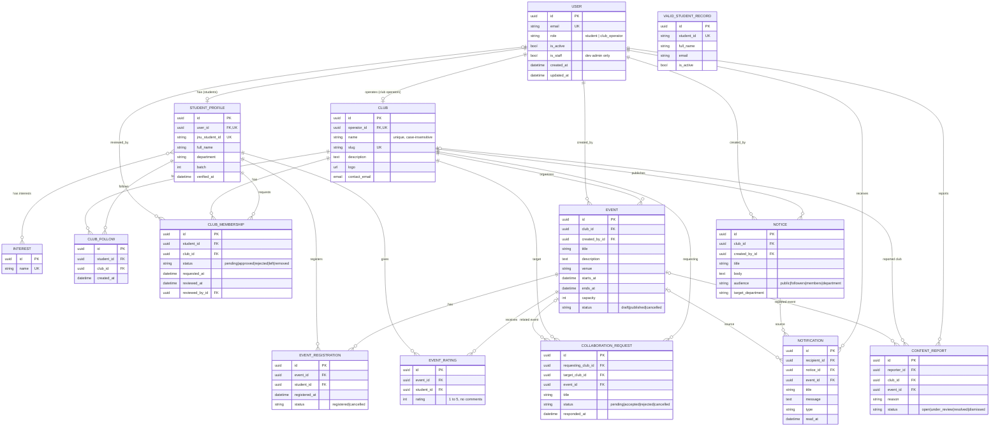

# JnUVerse — ER Diagram (Week 2)

Generated from the final Django models (accounts, clubs, events, notifications, feedback, collaborations, reports).
`VALID_STUDENT_RECORD` has no foreign keys: it is reference data matched by Student ID + email at registration.
GitHub renders the diagram below; `erd.png` is the same diagram as an image.

